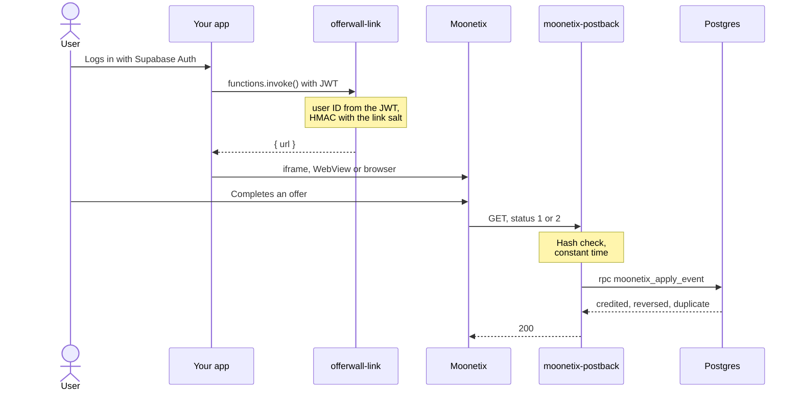

# Moonetix offerwall on Supabase

**Two Edge Functions and one SQL migration: a signed offerwall link for the logged-in user, and a postback that credits each transaction once inside Postgres.**

[](https://github.com/moonetix/offerwall-supabase/actions/workflows/ci.yml)
[](LICENSE)
[](https://docs.moonetix.com/postbacks)
[](https://moonetix.com/academy/integrations/offerwall-postback-supabase)
[](https://moonetix.com/register?from=github-offerwall-supabase)
[](https://moonetix.com)

[Moonetix](https://moonetix.com) is an affiliate network. Publishers add its offerwall, and their users earn the publisher's own currency by completing offers. Every credit and every reversal reaches your server as a signed postback. Here, that server is Supabase: an Edge Function checks the signature and one Postgres function applies the change in a single transaction.

> **Get your App ID and keys: sign up free at https://moonetix.com/register?from=github-offerwall-supabase**

## Design choices

1. **The database owns the money rules.** `moonetix_apply_event` takes an advisory lock on the transaction ID, checks the ledger, changes the wallet and writes the ledger row, all in one `rpc()` call. A `unique (transaction_id, status)` key backs it up. Only `service_role` may execute it.
2. **Clients can read, never write.** Row Level Security lets a user select their own wallet and ledger rows. Insert, update and delete are revoked from `anon` and `authenticated`, and the tests prove those roles get `permission denied`.
3. **No packages for the crypto.** The HMAC uses Web Crypto, and the constant-time comparison is ten lines in `_shared/moonetix.ts`. The same file runs in Deno and in the Node.js tests.

## How it fits together



## Quick start

You need the Supabase CLI and a Supabase project.

```bash
git clone https://github.com/moonetix/offerwall-supabase.git
cd offerwall-supabase
supabase link --project-ref YOUR_PROJECT_REF
supabase db push                                   # wallets, coin_ledger, RLS, moonetix_apply_event

supabase secrets set MOONETIX_APP_ID=your_app_id
supabase secrets set MOONETIX_LINK_SALT=your_link_hash_salt
supabase secrets set MOONETIX_POSTBACK_KEY=your_postback_secret_key

supabase functions deploy moonetix-postback
supabase functions deploy offerwall-link
```

`supabase/config.toml` turns `verify_jwt` off for `moonetix-postback` only, because Moonetix has no Supabase token. Keep it on for every other function. For local runs, copy `supabase/functions/.env.example` to `supabase/functions/.env`.

Save this postback URL on the Postback page of your Moonetix dashboard:

```text
https://YOUR_PROJECT_REF.supabase.co/functions/v1/moonetix-postback?tx={transaction_id}&user={user_id}&reward={reward}&status={status}&hash={hash}
```

In your app:

```js
const { data, error } = await supabase.functions.invoke('offerwall-link');
if (!error) document.querySelector('#offerwall').src = data.url;

const { data: wallet } = await supabase.from('wallets').select('coins').single();
```

| Secret | Required | Read by | Where to find it |
| --- | --- | --- | --- |
| `MOONETIX_APP_ID` | yes | `offerwall-link` | Offerwalls, your offerwall, Integration |
| `MOONETIX_LINK_SALT` | yes | `offerwall-link` | Same section: the link hash salt |
| `MOONETIX_POSTBACK_KEY` | yes | `moonetix-postback` | Postback page: the postback secret key |
| `MOONETIX_CREDIT_TEST_POSTBACKS` | no, default `false` | `moonetix-postback` | `true` credits dashboard tests (`test_` transaction IDs). Test projects only. |

`SUPABASE_URL` and the service role key are injected by the platform; you do not set them.

## How it works

1. `offerwall-link` runs with `auth: 'user'` from `@supabase/server`, so the platform and the wrapper verify the JWT. The user ID is `ctx.userClaims.id`, the `auth.users.id` UUID, which the offerwall accepts as is.
2. It returns `https://wall.moonetix.com/{APP_ID}?user_id={uuid}&hash={HMAC-SHA256(uuid, salt)}&sub1=supabase` with `Cache-Control: private, no-store`.
3. `moonetix-postback` accepts GET only (405 otherwise) and requires `tx`, `user`, `reward`, `status` and `hash` exactly once each (403 otherwise).
4. It computes the HMAC-SHA256 of `tx:user:reward:status` with Web Crypto and compares it in constant time. Wrong or short hashes get 403. A missing key gets 500, so nothing is ever signed with an empty key.
5. A signed status other than 1 or 2, or a malformed reward, gets 400. `test_` postbacks are logged and answered 200. A user ID that is not a UUID cannot be one of your users: logged, 200.
6. It calls `moonetix_apply_event` with the reward as a string, so the `numeric(24,6)` column receives it without floating point.

| Incoming | Already in the ledger | Result | Wallet |
| --- | --- | --- | --- |
| Status 1 | nothing | `credited` | plus the reward |
| Status 1 | any row | `duplicate` | unchanged |
| Status 2 | the credit | `reversed` | minus the stored amount, from the stored user |
| Status 2 | nothing | `not_credited` (zero row) | unchanged, a late credit is blocked |
| Status 2 | a reversal | `duplicate` | unchanged |
| Status 1 | no wallet for the user | `unknown_user` | nothing written |

7. Database errors give 500 and Moonetix retries up to 5 times. Everything applied or deliberately skipped gives 200.

| Path | Purpose |
| --- | --- |
| `supabase/migrations/20261111000000_moonetix_rewards.sql` | Tables, RLS, grants, wallet trigger, `moonetix_apply_event` |
| `supabase/functions/_shared/moonetix.ts` | Web Crypto HMAC, constant-time compare, link, parameter parsing |
| `supabase/functions/_shared/postback.ts` | The postback handler, independent of Supabase imports |
| `supabase/functions/moonetix-postback/index.ts` | Wires the handler to `ctx.supabaseAdmin.rpc` |
| `supabase/functions/offerwall-link/index.ts` | Signed link for the logged-in user |

## Security notes

- The link hash salt and postback key are Edge Function secrets. Never give them a public prefix or ship them to the client.
- The postback function runs without JWT verification on purpose. The HMAC is its access control, checked before any database call.
- `moonetix_apply_event` is `security invoker` and executable by `service_role` only. The sign-up trigger is the only `security definer` function, with `search_path = ''`.
- Only `{reward}` is signed. Never credit `{payout}` or any other unsigned macro.
- A reversal can take a wallet below zero. Say in your terms that rewards can be taken back.
- Reward only completed offers, never joins, invites, likes or reviews. Users must be 16 or older.

## Test it

```bash
npm test               # pure logic, no packages: link, hash, parsing, handler
npm ci && npm run test:sql
```

`npm test` runs on Node.js 22.18 or later, which loads the TypeScript files directly. It checks the link and the Web Crypto HMAC against the documented formulas, tampered, short, uppercase and wrongly signed postbacks, repeated parameters, the missing-key path, `test_` handling, and what reaches `rpc()`.

`npm run test:sql` runs the migration on [PGlite](https://pglite.dev) (PostgreSQL compiled to WebAssembly) with a small stand-in for the Supabase `auth` schema and roles. It checks every row of the table above, exact decimals, the unique key, RLS for `authenticated` and `anon`, the revoked grants, and signed postbacks going through the real handler into Postgres as `service_role`. PGlite has one connection, so parallel calls run one after another there; on a real server the advisory lock does that job.

The two `index.ts` wrappers are type-checked against `@supabase/server` 1.9.2 but need the Supabase runtime to execute. Before launch, deploy them and use the dashboard:

1. Offerwalls, your offerwall, Integration: **Check a link** and **Test a link** with a real user's UUID. It must match what `offerwall-link` returns.
2. **Send a test postback** (or use the Postback page). The function log shows `moonetix: test postback (not credited)`.
3. Reports, Postbacks lists every attempt and the status your function returned.

## Troubleshooting

`moonetix-postback` answers with an empty body. Match the status code in Reports, Postbacks with the function log in the Supabase dashboard (Edge Functions, `moonetix-postback`, Logs).

| Symptom | Cause | Fix |
| --- | --- | --- |
| 401 | The platform checked for a JWT, so `verify_jwt = false` did not reach the deployed function. | Deploy from the repo root so `supabase/config.toml` is read, or deploy with `--no-verify-jwt`. |
| 403 | A required parameter is missing or repeated, or the hash does not match. | Use the postback secret key, not the link hash salt. Paste the logged URL into the [hash checker](https://moonetix.com/tools/postback-hash-checker). |
| 400, log `postback with unexpected values` | Signed, but the status is not 1 or 2, the reward is not a plain number, or `tx` is empty or over 255 characters. | Compare the saved postback URL with the one above. |
| 500, log `MOONETIX_POSTBACK_KEY is not set` | The secret is missing. | `supabase secrets set MOONETIX_POSTBACK_KEY=...` |
| 500, log `postback failed` | The `rpc()` call failed, most often because the migration was not pushed. Nothing was stored. | Run `supabase db push`. Moonetix retries. |
| 200, nothing credited | A `test_` postback, a user ID that is not a UUID, or `unknown_user` (no wallet row). | Sign links with `auth.users.id`. The migration creates wallets for existing users and a trigger adds them on sign-up. |

## Learn more

- Academy: [Offerwall postback with Supabase Edge Functions](https://moonetix.com/academy/integrations/offerwall-postback-supabase), the step by step version of this repo
- Academy: [Prevent duplicate reward credits](https://moonetix.com/academy/integrations/prevent-duplicate-reward-credits)
- Docs: [Postbacks](https://docs.moonetix.com/postbacks), [Offerwall link](https://docs.moonetix.com/offerwall-link), [Credits and reversals](https://docs.moonetix.com/credits-and-reversals), [Testing](https://docs.moonetix.com/testing)
- Moonetix for [web apps](https://moonetix.com/industries/web-apps) and [websites](https://moonetix.com/integrations/website)
- Tools: [postback hash checker](https://moonetix.com/tools/postback-hash-checker), [offerwall link builder](https://moonetix.com/tools/offerwall-link-builder)

## Start earning

**Get your App ID and keys: sign up free at https://moonetix.com/register?from=github-offerwall-supabase**

Every publisher application is reviewed by hand. Once you are approved, paste the keys into your Supabase secrets and send a test postback.


## More Moonetix examples

| Repository | What it covers |
| --- | --- |
| [awesome-offerwalls](https://github.com/moonetix/awesome-offerwalls) | Curated list of offerwall networks, tools and guides |
| [offerwall-postback-handlers](https://github.com/moonetix/offerwall-postback-handlers) | Postback handlers in PHP, Node.js, Python and Java |
| [offerwall-nextjs-starter](https://github.com/moonetix/offerwall-nextjs-starter) | Next.js App Router starter |
| [telegram-mini-app-offerwall](https://github.com/moonetix/telegram-mini-app-offerwall) | Telegram Mini App with server-side `initData` checks |
| [discord-rewards-bot](https://github.com/moonetix/discord-rewards-bot) | Discord bot with an economy and offerwall rewards |
| [moonetix-offerwall-wordpress](https://github.com/moonetix/moonetix-offerwall-wordpress) | WordPress plugin |
| [offerwall-laravel](https://github.com/moonetix/offerwall-laravel) | Laravel integration |
| [offerwall-django](https://github.com/moonetix/offerwall-django) | Django integration |
| [offerwall-express](https://github.com/moonetix/offerwall-express) | Express integration |
| [offerwall-vue-nuxt](https://github.com/moonetix/offerwall-vue-nuxt) | Vue and Nuxt integration |
| [offerwall-react-vite](https://github.com/moonetix/offerwall-react-vite) | React and Vite app with a small Node.js backend |
| [rewards-site-starter](https://github.com/moonetix/rewards-site-starter) | Rewards (GPT) site starter in PHP and SQLite |
| [offerwall-godot](https://github.com/moonetix/offerwall-godot) | Godot integration |
| [offerwall-flutter-example](https://github.com/moonetix/offerwall-flutter-example) | Flutter sample app |
| [postback-tester](https://github.com/moonetix/postback-tester) | Sends signed test postbacks and catches double credits, missed reversals and forged requests |
| [signup-guard](https://github.com/moonetix/signup-guard) | Sign-up risk checks for Node.js and PHP: disposable emails, datacenter and Tor IPs |
| [datacenter-ip-ranges](https://github.com/moonetix/datacenter-ip-ranges) | Daily cloud, Tor and iCloud Private Relay IP ranges from official feeds |
| [offerwall-fraud-playbook](https://github.com/moonetix/offerwall-fraud-playbook) | Fraud playbook for offerwall and rewards publishers, with tested code |
| [reward-economy-kit](https://github.com/moonetix/reward-economy-kit) | Integer points math: payout to points, bonuses, reversals, cash-out pricing |
| [referral-engine](https://github.com/moonetix/referral-engine) | Referral codes, attribution and a clawback-safe commission ledger |
| [gamification-kit](https://github.com/moonetix/gamification-kit) | Streaks, XP levels, quests and leaderboards that survive time zones and DST |
| [affiliate-postback-macros](https://github.com/moonetix/affiliate-postback-macros) | Postback macros and signatures of tracking platforms and offerwalls |
| [country-tiers](https://github.com/moonetix/country-tiers) | Tier 1, 2 and 3 countries as JSON and CSV, with helpers in JavaScript, PHP and Python |

## License

MIT. See [LICENSE](LICENSE).
